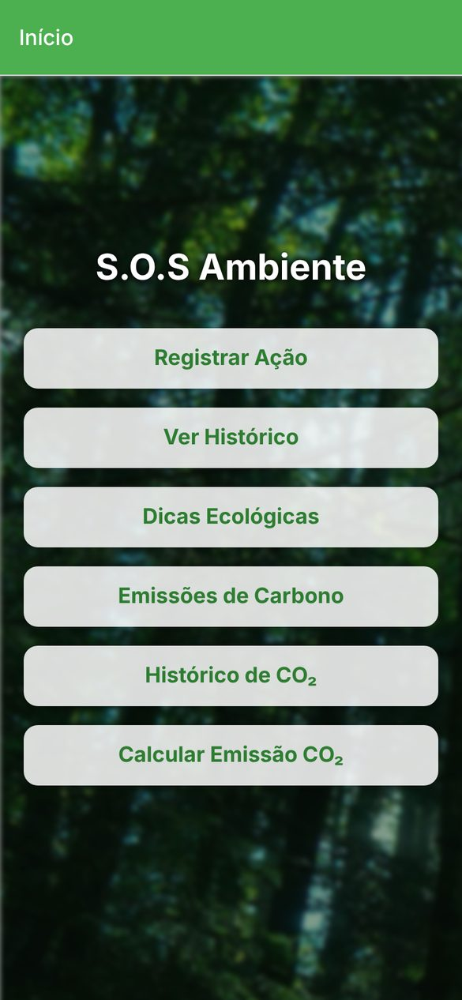
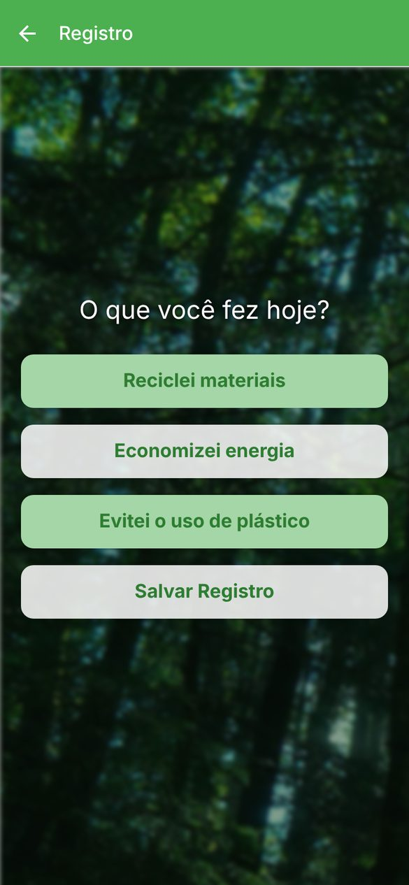
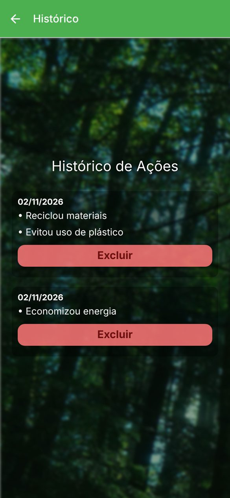
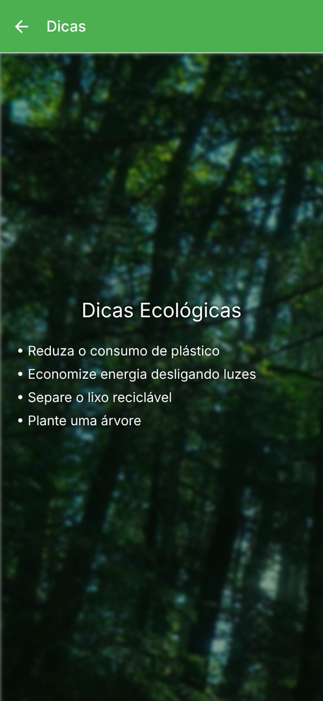
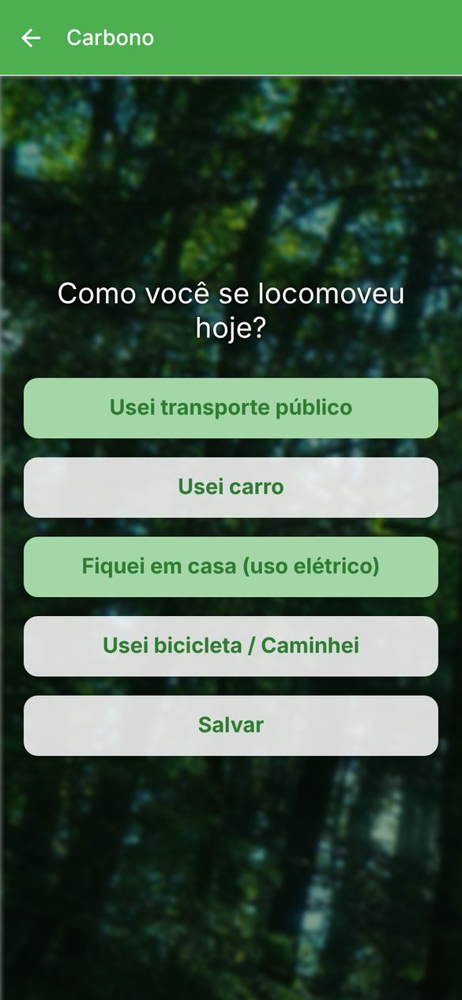
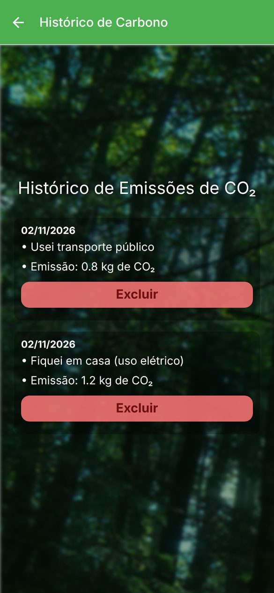
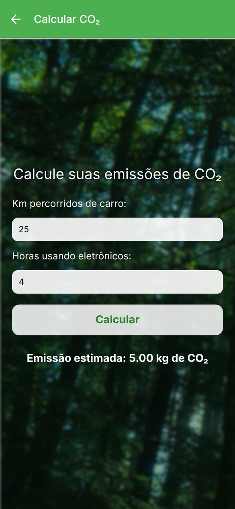

# S.O.S Ambiente

Mobile app for logging everyday eco-friendly actions and estimating CO₂ emissions, built with React Native and Expo. Users record what they did for the environment, log how they got around, calculate emissions from car trips and screen time, and review or delete past entries. ("Ambiente" is Portuguese for environment.)

The app interface is in Brazilian Portuguese.


## Screenshots

Captured from the web build in a phone-sized window (390x844).

| Splash | Home | Register action | Action history |
|---|---|---|---|
|  |  |  |  |

| Tips | Transport log | CO₂ history | CO₂ calculator |
|---|---|---|---|
|  |  |  |  |

From opening the app to a CO₂ estimate: register two actions, check the history and run the calculator.


## About

I built S.O.S Ambiente in August 2025 as a study project in React Native. It covers stack navigation, shared state with the Context API, multi-select forms and a small calculation screen, with one background component shared by every screen after the splash.

## Features

- Action log: pick one or more of three actions (recycling, saving energy, avoiding plastic) and save them as a dated entry. Saving with nothing selected shows a warning.
- Action history: entries listed by date, each with a delete button that asks for confirmation.
- Transport log: pick one or more options for the day (public transport, car, staying home, bike or walking). Each option is saved as its own entry with a fixed CO₂ value.
- CO₂ history: logged options with their emissions, also with delete and confirmation.
- CO₂ calculator: enter kilometers driven and hours using electronics to get an estimate in kg of CO₂.
- Tips screen with four eco-friendly habits.
- Splash screen where the title fades in over the background before the app opens.

## How it works

### Shared state

[`src/context/AppState.js`](src/context/AppState.js) holds two lists, `historico` (actions) and `historicoCarbono` (CO₂ entries), in a React context. The register screens add to them and the history screens read and filter them, so a new entry shows up in its history without any extra loading.

### Navigation

A native stack navigator ([`src/navigation/index.js`](src/navigation/index.js)) with a green header. The splash screen moves on with `navigation.replace`, so the back button never returns to it, and the register screens call `navigation.goBack()` after saving.

### Emission values

The transport log uses fixed values per option, defined in [`src/screens/CarbonoScreen.js`](src/screens/CarbonoScreen.js):

| Option | CO₂ per entry |
|---|---|
| Public transport | 0.8 kg |
| Car | 2.5 kg |
| Staying home (electricity) | 1.2 kg |
| Bike or walking | 0 kg |

The calculator in [`src/screens/CalculoCarbonoScreen.js`](src/screens/CalculoCarbonoScreen.js) multiplies kilometers by 0.192 kg/km and hours of electronics by 0.05 kg/h. For example, 25 km and 4 hours give 4.80 + 0.20 = 5.00 kg.

### Background

[`src/components/TelaComFundo.js`](src/components/TelaComFundo.js) wraps every screen after the splash in the forest photo, a slight blur, a dark overlay for contrast and a `ScrollView`, so each screen only declares its own content.

## Limitations

This is a front-end study project:

- Entries live in memory only and are lost when the app closes. AsyncStorage is already a dependency, so saving the two lists is the natural next step.
- The emission values are fixed approximations in the code. The transport log assigns one value per option, whatever the distance.
- Delete confirmations and warnings use `Alert.alert`, which shows no buttons in the web build, so deleting entries works on Android and iOS only.

## Tech stack

- React Native 0.79 and React 19
- Expo SDK 53
- React Navigation 7 (native stack)
- React Context API for shared state
- ESLint with eslint-config-expo

## Project structure

```
.
├── App.js                     # entry point: state provider and navigation container
├── app.json                   # Expo config (name, icons, splash)
├── assets/images/             # app icons, splash icon, favicon and forest background
└── src/
    ├── components/
    │   └── TelaComFundo.js    # background wrapper used by every screen
    ├── context/AppState.js    # shared lists for actions and CO₂ entries
    ├── navigation/index.js    # stack navigator
    ├── screens/               # one file per screen
    └── styles/global.js       # shared StyleSheet
```

Screen files keep Portuguese names: `HomeScreen`, `RegistroScreen` (register action), `HistoricoScreen` (action history), `DicasScreen` (tips), `CarbonoScreen` (transport log), `HistoricoCarbonoScreen` (CO₂ history), `CalculoCarbonoScreen` (calculator) and `SplashScreen`.

## Getting started

Requires Node.js 20 or newer, plus Expo Go, an Android emulator or the iOS simulator.

```bash
git clone https://github.com/PedroRossZny/sos-ambiente.git
cd sos-ambiente
npm install
npm start
```

`npm start` opens the Expo dev server. Scan the QR code with Expo Go, or press `a` for Android, `i` for iOS or `w` for the browser.

Expo Go from the app stores only runs the latest Expo SDK. If yours is newer than SDK 53, open the app on an Android emulator with `npm run android` (Expo installs a matching Expo Go there) or use the web version.

| Script | What it does |
|---|---|
| `npm start` | starts the Expo dev server |
| `npm run android` | opens the app on an Android emulator or device |
| `npm run ios` | opens the app on the iOS simulator (macOS only) |
| `npm run web` | opens the app in the browser |
| `npm run lint` | runs ESLint |

## License

The code is released under the [MIT License](LICENSE). The background photo is not covered by it.

## Author

Pedro Ross. [GitHub](https://github.com/PedroRossZny) | [LinkedIn](https://www.linkedin.com/in/pedro-ross)
